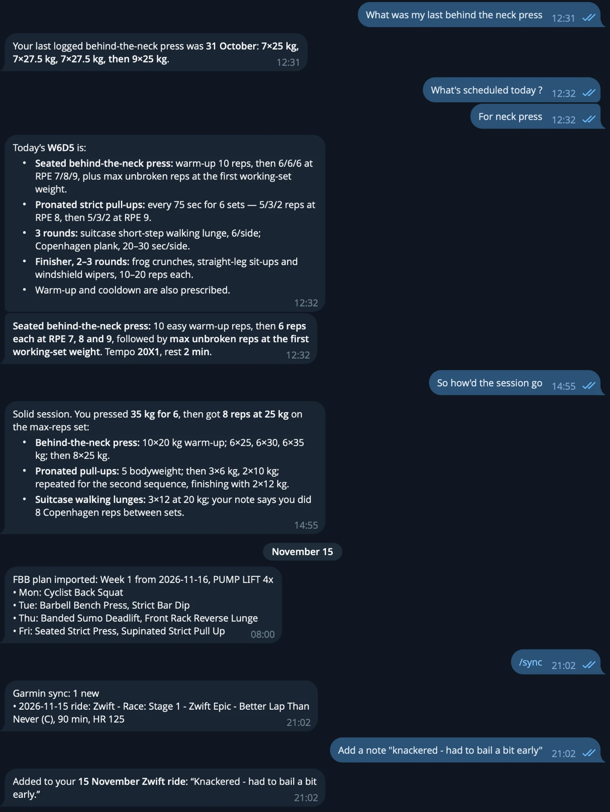
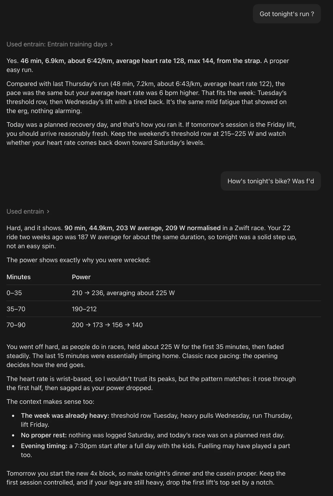
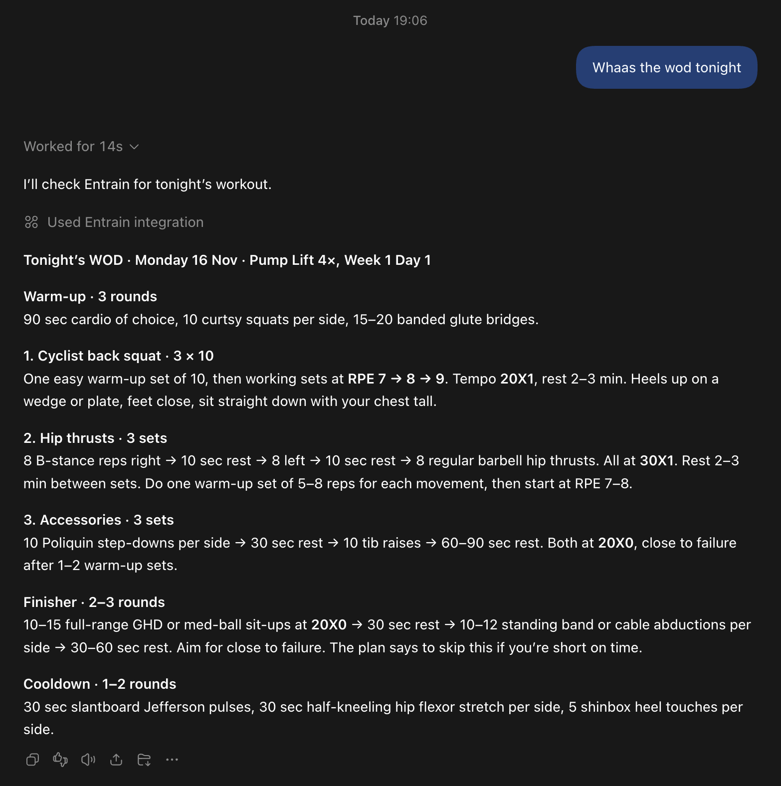

I've always wanted a unified view of my strength and cardio data. CrossFit apps, strength trackers, spreadsheets, Strava, TrainingPeaks all fell short in various ways.

My recent experience using agents suggested I could build something from scratch that cracked it. It'd need to unify lifting data from [SeshinLog](/posts/minimalStrengthLoggingHonoD1/); runs, swims, bikes from Garmin; Zwift for the turbo; Concept2 ErgData for rows. I also wanted to pull in the programme I subscribe to.

Success = asking a load of questions and getting info back without having to look stuff up, e.g.:
- Legs tired from yesterday's race, how should I think about fueling today?
- How did my heart rate on this row compare to last time given watts were only about 30 higher?
- How has my back squat progressed over the last quarter?
- Bad night's sleep, how should I adjust the session given recent training load?
- What's tonight's training programme? What did I do on that lift last time I did it?

## Building it

Claude wrote almost all of it in about three hours of back and forth, then I tweaked it over the following week of live use. My part was mostly the architecture, all of it on Cloudflare. 

<figure style="margin: 2rem 0; text-align: center">
  
</figure>

### Decisions

#### 1. Dealing with messy data

Spent the first hour on experiments and getting Claude to extract and compare data before deciding on a schema.

- Wrist heart-rate is iffy: optical sensors spike and lock onto cadence. Arm strap is better, chest strap better still.
- Average heart-rate and watt data include rests in Garmin. A 4x2000 m row at 228 W reads as 165 W in Garmin's summary. Teach the model to hunt for the pieces and average those.
- Lift variants go into notes. Instead of three exercises for 'wide-grip bench', 'narrow-grip bench', 'decline bench' etc., I have 'bench press' and write the variant in the notes. Cue agent needing to be taught to read SeshinLog notes as well as exercise name.

#### 2. What to store

- Zwift and ErgData both push sessions to Garmin Connect, so only need to pull from Garmin Connect! Luckily Garmin recently launched a personal API token that lets you query your own stuff.
- Lifts stay in SeshinLog, Entrain (my name for this tool) reads its database. The two databases join on the local date (as in, assume a Garmin strength session on Monday 16 November is the same session as the lifts logged in SeshinLog that day, cos I generally only work out once a day).
- **FIT files hold detail.** Every Garmin activity's original FIT file goes into R2. D1 holds an index: one row per activity with date, sport, duration, averages and where the heart rate came from (wrist, arm strap, chest strap).

#### 3. Rule encoding

Plonked the rules in `rules.ts`, which gets injected into the model's prompt. Basic stuff: which source to trust for what, how to match lifts to the planned session, and when to fetch interval data instead of trusting watt or heart rate averages.

#### 4. Agent tooling

The agent gets:

- Session query: what was logged over a chosen date range
- Plan query: what was prescribed
- Interval slicing: accurate heart rate and watts for the work pieces
- Note adding: context like "felt knackered today"

### Tweaks once live

Swapping models changed answers more than I expected. So I built a small eval suite: a frozen clock, a snapshot of both databases, a canned sync, a few real questions. It runs each case in a fresh agent and writes an HTML report I read through. No automatic grading. It's caught stale dates, misread empty syncs and inaccurate interval results.

## Using it

### Telegram

Telegram bot I message directly. Telegram hits a webhook on the Worker, which runs the agent. The harness is Think, from Cloudflare's Agents SDK: it handles the chat history, tool calls and scheduled syncs. The model itself is called through OpenRouter and Cloudflare's AI Gateway. `/sync` and `/plan` skip the model entirely and just run the import.

Useful and convenient, but every call goes through OpenRouter, so I pay per message on top of the subscriptions I already have. With GPT-6 Luna or DeepSeek that's fractions of a penny.

### Claude and ChatGPT via MCP

Adding an MCP server and putting it behind Cloudflare Access lets me hook it into ChatGPT and Claude to query direct. This gives me voice, agent memory, and the mobile apps, all out of the subscriptions I'm already paying for. Insanely useful to be able to talk to the agent mid-session. Considering giving it write tools to SeshinLog so I can finish my sets and say "60kg first set, 70 second, 80 third" and no longer have to type.

